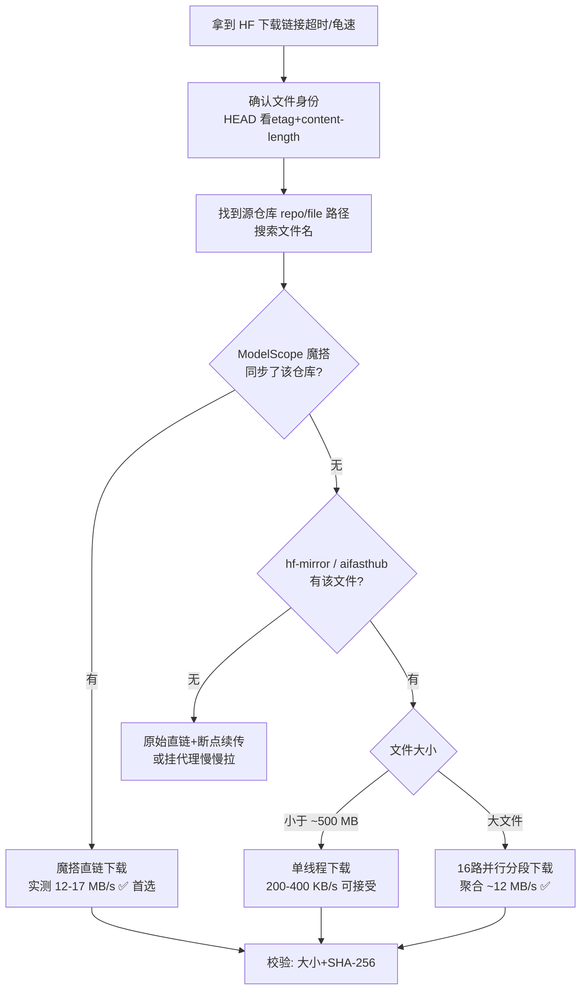

# HuggingFace 下载超时/慢速应对方案

> 场景：从 huggingface.co（含 hf CDN 签名直链）下载大模型文件超时或只有几十~几百 KB/s。2026-10-24 两个真实案例（9.35 GB safetensors、4.6 GB gguf）沉淀的流程。

## 决策流程



## 各通道实测速度（2026-10-24）

| 通道 | 实测速度 | 适用 |
|---|---|---|
| HF 直链（国内直连） | 0.1~0.2 MB/s | 兜底 |
| hf-mirror.com / aifasthub.com 单线程 | 0.2~0.4 MB/s | 小文件 |
| **hf-mirror 16 路并行分段** | **聚合 ~12.5 MB/s** | 无魔搭镜像的大文件 |
| **ModelScope 魔搭（仓库已同步时）** | **12~17 MB/s** | ✅ 永远先查 |

## 第 0 步：确认文件身份（防下错/被投毒）

对原始 URL 发 HEAD，记录 `etag` 和 `content-length`，后续所有换源下载都用它们比对：

```bash
curl -sS -I "原始URL" | grep -iE "^(HTTP|content-length|etag)"
```

- xet 链接的 `etag` 是内容哈希（xet 标识），**不等于** SHA-256，只用于确认"是同一个文件"。
- 签名直链带 `Expires/Policy/Signature`，过期即 403，但有效期内支持 Range 断点续传。

同时搜索文件名找到源仓库（`repo/file路径` 是一切镜像 URL 的基础）：

```
https://huggingface.co/<owner>/<repo>/resolve/main/<path/to/file>
```

## 第 1 优先：ModelScope 魔搭（国内最快）

查仓库是否被同步（`Success:false, record not found` = 没同步）：

```bash
curl -sS "https://www.modelscope.cn/api/v1/models/<owner>/<repo>/repo/files?Recursive=true"
```

魔搭直链把 `main` 换成 `master`，其余路径不变，支持 `-C -` 断点续传：

```bash
curl -L -C - --retry 8 --retry-delay 5 --retry-all-errors \
  -o <文件名> \
  "https://www.modelscope.cn/models/<owner>/<repo>/resolve/master/<path/to/file>"
```

⚠️ 同名不同物陷阱：搜索时可能冒出同名社区仓库，**必须比对 ETag/大小**（案例 1 中 `Stick9190/qwen3vl_8b_int8_convrot` 与目标同名但差 1.6 GB）。

## 第 2 优先：hf-mirror / aifasthub

```bash
curl -sSL -I "https://hf-mirror.com/<owner>/<repo>/resolve/main/<path>"   # 确认200+大小
curl -L -C - --retry 8 --retry-all-errors -o <文件名> "https://hf-mirror.com/<owner>/<repo>/resolve/main/<path>"
```

- 响应头 `X-Linked-Etag` = LFS 内容哈希 = **文件真实 SHA-256**（校验用）。
- 单线程只有 ~0.2-0.4 MB/s（瓶颈在国际回源链路），大文件用下面的并行方案。

## 大文件杀招：多连接并行分段（实测 4.6 GB / 368 秒）

原理：单连接被限速，N 路 Range 分段各下各的，完成后按序拼接。把脚本存为 `dl.sh`，改开头三个变量即可复用：

```bash
#!/usr/bin/env bash
# 用法: URL=目标 SIZE=字节数 N=并发数 bash dl.sh 输出文件名
set -u
URL="https://hf-mirror.com/<owner>/<repo>/resolve/main/<path>"
SIZE=0   # 填 content-length
N=16
OUT="${1:?output file}"
CHUNK=$(( (SIZE + N - 1) / N ))
DIR=".parts_$$"
mkdir -p "$DIR"

download_chunk() {
  local i=$1 S=$2 E=$3 f="$DIR/part_$(printf '%02d' "$i")"
  local want=$((E - S + 1)) have=0 tries=0
  while [ "$have" -lt "$want" ] && [ "$tries" -lt 300 ]; do
    tries=$((tries + 1))
    have=0; [ -f "$f" ] && have=$(stat -c %s "$f" 2>/dev/null || echo 0)
    [ "$have" -ge "$want" ] && break
    curl -sSL --max-time 3600 --speed-time 30 --speed-limit 10240 \
      -r $((S + have))-$E -o - "$URL" >> "$f" 2>/dev/null   # 追加续传
    sleep 1
  done
  have=$(stat -c %s "$f" 2>/dev/null || echo 0)
  echo "chunk $i: $have / $want"
  [ "$have" -eq "$want" ] || exit 1
}

pids=()
for i in $(seq 0 $((N - 1))); do
  S=$((i * CHUNK)); E=$((S + CHUNK - 1)); [ "$E" -ge "$SIZE" ] && E=$((SIZE - 1))
  download_chunk "$i" "$S" "$E" & pids+=($!)
done
fail=0; for p in "${pids[@]}"; do wait "$p" || fail=1; done
[ "$fail" -eq 0 ] || { echo "FAILED: some chunks incomplete"; exit 1; }

cat "$DIR"/part_* > "$OUT"
got=$(stat -c %s "$OUT"); echo "size: $got (expect $SIZE)"
[ "$got" -eq "$SIZE" ] && rm -rf "$DIR" && echo "sha256: $(sha256sum "$OUT" | cut -d' ' -f1)"
```

要点：
- 各分段独立断点续传（`-r $((S+have))-`），某段断了重跑脚本只补缺口。
- `--speed-limit 10240 --speed-time 30`：30 秒低于 10 KB/s 自动掐断重连，防假死。
- N 从 8 起试，16 通常够；再大容易触发镜像站限流。

## 最后一步：完整性校验（必做）

```bash
stat -c %s <文件>                                # 大小须与 content-length 一字不差
sha256sum <文件>                                 # Git Bash / Linux
certutil -hashfile <文件> SHA256                 # Windows cmd
```

权威 SHA-256 从哪来：
1. ModelScope `repo/files` API 的 `Sha256` 字段；
2. hf-mirror 响应头 `X-Linked-Etag`；
3. 模型卡 README（认真写的仓库会贴）。
对不上就删掉重下，不要碰运气。

---

# 案例档案

## 案例 1：`qwen3vl_8b_int8_convrot.safetensors`（9.35 GB，走魔搭）

| 项 | 值 |
|---|---|
| 来源仓库 | `Comfy-Org/Qwen-Image-2.1` → `text_encoders/…` |
| xet 标识（原链接 ETag） | `05a94aec9c924009948b9904abc0dbb7d5ec718728d330126f7feeabdc15760d` |
| 通道 | ModelScope（官方同步该仓库），均速 17.5 MB/s，约 15 分钟 |
| SHA-256 ✅ | `8bfd0f6e12abf2d2d697ecc888e5e90b0d6741d6708f05799f53afa560452e8f`（与魔搭 API 权威值一致） |
| 排除 | `Stick9190/qwen3vl_8b_int8_convrot` 同名仓库，10.99 GB，ETag 不同 |
| 中途波折 | schannel 断连 1 次，`--retry-all-errors` 自动续传解决 |

魔搭直链：

```bash
curl -L -C - --retry 8 --retry-all-errors -o qwen3vl_8b_int8_convrot.safetensors \
  "https://www.modelscope.cn/models/Comfy-Org/Qwen-Image-2.1/resolve/master/text_encoders/qwen3vl_8b_int8_convrot.safetensors"
```

## 案例 2：`qwen-image-2.1-UC-Q4_K_M.gguf`（4.6 GB，魔搭无镜像 → 16 路并行）

| 项 | 值 |
|---|---|
| 来源仓库 | `abenzerps/Qwen-Image-2.1-Uncensored-GGUF`（社区仓，魔搭 record not found） |
| xet 标识（原链接 ETag） | `f05b3c8d81d88c7dea63a5ff63d48dbe80358dafaf6a0a5adae94d33ba41dd80` |
| 通道 | hf-mirror 16 路并行分段，聚合 ~12.5 MB/s，368 秒 |
| SHA-256 ✅ | `e79c8a009f2ecbdb6c70fd663d9aea9ee304a0d91f347e4169a756b8ad141b41`（与 `X-Linked-Etag` 一致） |
| 备注 | aifasthub 有同名镜像（路径为 `…-Uncensored-Quantized`）但同为回源中转，单线程同样 ~230 KB/s |

## 速度对照总表

| 通道 | 案例1 (9.35 GB) | 案例2 (4.6 GB) |
|---|---|---|
| HF 直链单线程 | 205 KB/s | 119 KB/s |
| 镜像单线程 | 405 KB/s（hf-mirror） | 230 KB/s（hf-mirror/aifasthub） |
| 最终方案 | 魔搭 17.5 MB/s | hf-mirror ×16 ≈ 12.5 MB/s |
| 耗时 | ~15 分钟 | ~6 分钟 |

## 案例 3：`qwen_image_2.1_int8_convrot.safetensors`（6.76 GB，走魔搭）

| 项 | 值 |
|---|---|
| 来源仓库 | `Comfy-Org/Qwen-Image-2.1` → `diffusion_models/qwen_image_2.1_int8_convrot.safetensors` |
| 大小 | 7,256,783,064 字节 |
| 通道 | ModelScope 单线程直下，19.7 MB/s，368 秒，一次成功无断连 |
| SHA-256 ✅ | `cb74113cb03faecd79611b01fd7fd642f0aa60d6f0b95086abee214d75eaa57d`（与魔搭 API 权威值一致） |

```bash
curl -L -C - --retry 8 --retry-all-errors -o qwen_image_2.1_int8_convrot.safetensors \
  "https://www.modelscope.cn/models/Comfy-Org/Qwen-Image-2.1/resolve/master/diffusion_models/qwen_image_2.1_int8_convrot.safetensors"
```
